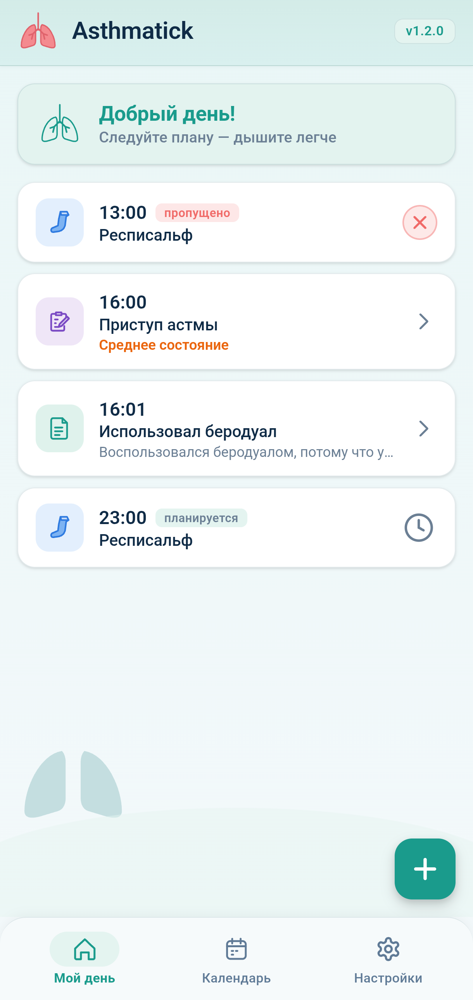
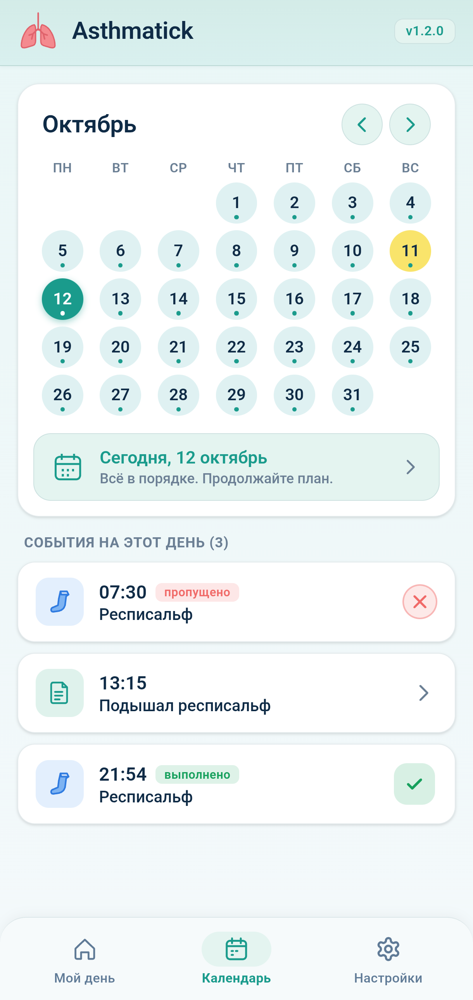
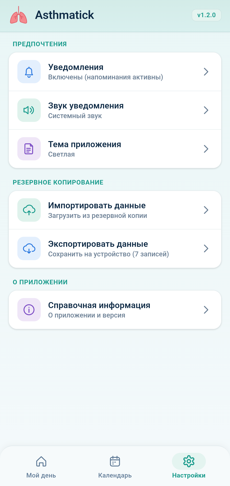

# Asthmatick

Быстрый, современный и удобный трекер приступов, дневник самочувствия и расписания приёма лекарств при астме на **Android**. Интерфейс доступен на русском и английском языках.

## ⚡ Возможности

- 🕒 **План приёма лекарств и ингаляций** — расписание с напоминаниями и контролем выполнения
- ⏱️ **Умный контроль (±1 час)** — отметить приём можно за 1 час до или в течение 1 часа после назначенного времени
- ❌ **Контроль пропусков** — если прошёл час, событие автоматически помечается пропущенным
- 📝 **Фиксация точного времени** — сохраняет фактическое время приёма без изменения расписания на будущие дни
- 🫁 **Дневник приступов и одышки** — удобная градация состояния: легкая одышка, выраженная одышка, удушье
- 📅 **Наглядный календарь** — история самочувствия и приёмов лекарств по дням
- 🔒 **100% приватность** — все данные хранятся локально на вашем устройстве, без серверов
- 💾 **SQLite на Android** — данные находятся во внутреннем хранилище приложения и сохраняются при очистке кэша WebView; записи из предыдущей версии переносятся автоматически
- 📊 **Статистика** — выполненные и пропущенные приёмы, количество приступов по тяжести за неделю, месяц или свой период
- 💾 **Экспорт и импорт** — резервная копия SQLite (.db) в выбранную папку на телефоне и восстановление из файла
- 🎨 **Интерфейс Material Design 3 (MD3)** — современный дизайн, скругленные формы карточек, M3 Navigation Bar и плавная анимация
- 🌈 **Динамическая тема MD3 (Material You)** — гармоничная адаптация цветов приложения под системные обои телефона
- 🖼️ **Тематическая иконка (MD3 Themed Icon)** — монохромная иконка на рабочих столах Android 13+ в цвет системной палитры
- 🌓 **Светлая и тёмная темы** — комфортное использование в любое время суток
- 🌐 **Русский и английский интерфейс** — язык можно выбрать в инструкции и настройках
- 📱 **Адаптивная вёрстка** — интерфейс подстраивается под телефоны и планшеты

## 📸 Скриншоты

  

## 📥 Скачать

### RuStore
Установите приложение из каталога [**RuStore**](https://www.rustore.ru/catalog/app/app.asthma.tick).

### Прямая установка (GitHub Releases)
1. Перейдите на страницу [**Releases**](../../releases)
2. Скачайте актуальный файл `Asthmatick.apk`
3. Запустите и установите на ваш Android-смартфон

> Не требует регистрации и интернета. Все данные и настройки хранятся только на вашем устройстве. Очистка кэша сохраняет SQLite-базу; удаление приложения или очистка его данных удаляет базу. Для переноса используйте экспорт в настройках.

## ⚠️ Медицинский отказ

Приложение разработано в ознакомительных целях для самоконтроля расписания и не является медицинским продуктом или заменой консультации врача. При ухудшении состояния немедленно обращайтесь за медицинской помощью.

## 📄 Лицензия

[MIT](LICENSE)

---

  

